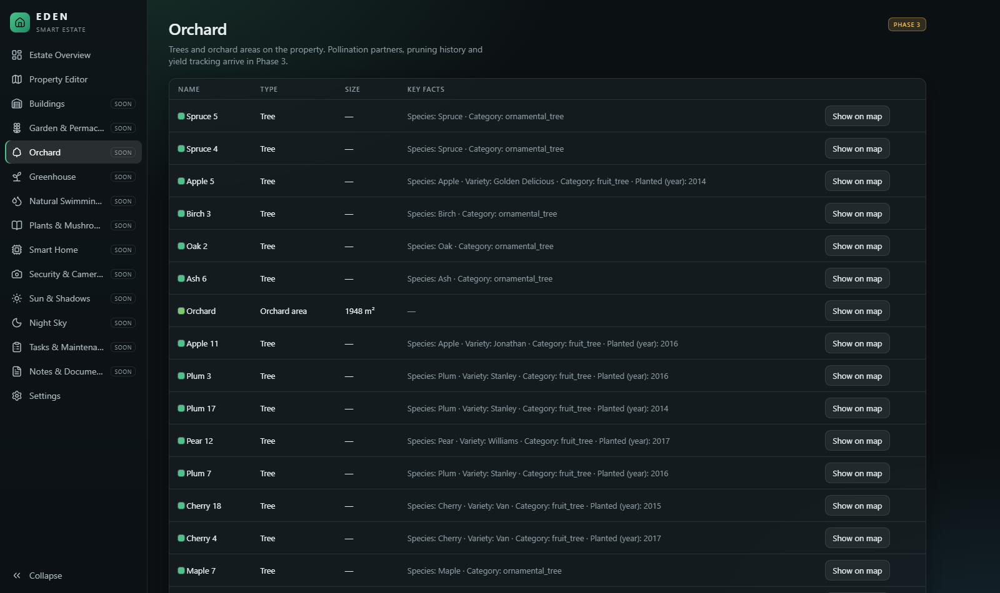

# EDEN — Smart Estate

**A digital twin of your land.** Open a satellite image of your real property, trace its boundary, and gradually turn it into an editable, measured, geographic model — buildings, fences, trees, garden zones, a greenhouse, a pond — stored on your own computer, no cloud subscription required.

> **Status: v0.1.0 — Phase 1 + 2 (foundation and Property Editor).**
> The map, object system, editor, measurements, layers, image calibration, 3D view, import/export and backup are built and tested. The remaining modules (garden/orchard designers, sun & shadows, night sky, smart home, cameras, tasks, plant library…) are on the [roadmap](#roadmap) and are shown in the app as clearly-marked *soon* pages. EDEN never fakes sensor values, camera feeds or device connections.


## What works today

**Map and imagery**
- Satellite, hybrid, street and terrain base maps through a **configurable provider layer** (Esri World Imagery out of the box, MapTiler or any XYZ tile server with your own key). No tile scraping; provider attribution is always shown. API keys stay on the server and are never sent to the browser.
- Search by place name or by `lat, lng` coordinates.
- **Bring your own aerial photo or plan:** import a PNG/JPEG/WebP and calibrate it with two known points, a known distance + bearing, or a world file.

**Property editor**
- Draw **property boundary, zones, buildings (12 presets), greenhouses, fences (6 types), hedges, gates, roads, paths, garden beds, trees (13 fruit/nut presets), bushes, plants, ponds and pond zones, pipes, drainage, cables, smart outlets, cameras, lights, sensors, solar and notes.**
- Polygons as free shapes, rectangles or circles; lines and points; **snapping** to existing corners and edges.
- Every shape stays editable: **move, reshape (drag corners), add corners (drag edge handles), remove corners (right-click), rotate (handle or numeric), scale, duplicate, delete, rename, recolour, move between layers.**
- Per-object properties panel: dimensions, floors, height, roof type, materials, services, species, canopy, fence type/height/sections, camera direction and field of view (drawn as a coverage wedge), status, description and notes.
- **Live measurements:** property area (m² and ha), perimeter, edge lengths, polygon areas, fence/path lengths, plus *Distance* and *Area* measuring tools.
- **Layers** (17 ready-made): show/hide, lock, rename, recolour, reorder, add your own.
- **Unlimited undo/redo** (Ctrl+Z / Ctrl+Y) and **autosave** to the local database.
- **2D ↔ 3D** toggle: buildings, greenhouses, tree crowns, fences and hedges extruded from the very same objects.
- Import GeoJSON/KML; export GeoJSON, KML, CSV and a full EDEN project file; one-click full **backup & restore** (database + images).
- A fictional, clearly labelled **DEMO estate** you can explore and delete.

| Select and edit | 3D view |
|---|---|
|  |  |
| **Layers** | **Measuring** |
|  |  |

<details><summary>More screenshots</summary>





</details>

> The screenshots show the fictional demo estate placed on a random open meadow. It is not a real property.

## Install (Windows 11)

You need **Python 3.11 or newer** ([python.org](https://www.python.org/downloads/), tick *Add python.exe to PATH*). Node.js is only needed if you build from source.

```powershell
git clone https://github.com/unupunct/Eden-Smart-Estate.git
cd Eden-Smart-Estate
powershell -ExecutionPolicy Bypass -File scripts\install.ps1
powershell -ExecutionPolicy Bypass -File scripts\start.ps1
```

Your browser opens at <http://127.0.0.1:8787>. Click **Explore the demo estate**, or **Create my property**.

The complete guide — release zip, LAN/tablet access, autostart, updating, backup, troubleshooting — is in **[docs/INSTALL.md](docs/INSTALL.md)**.

## Documentation

| | |
|---|---|
| [Installation guide](docs/INSTALL.md) | Step by step, plus LAN access, autostart, updates, troubleshooting |
| [User guide](docs/USER_GUIDE.md) | Drawing, editing, layers, measuring, image calibration, shortcuts |
| [Architecture & data model](docs/ARCHITECTURE.md) | Object model, coordinates, autosave/undo design, database schema |
| [API & integrations](docs/API.md) | REST endpoints, import/export formats, imagery providers, key handling |
| [Development](docs/DEVELOPMENT.md) | Build, test, extend (new object kinds, migrations, providers) |

## Tech

React 18 + TypeScript + Vite · MapLibre GL JS (maps, 2D/3D) · Zustand · FastAPI · SQLite (portable SQL, ready for PostgreSQL) · 40 frontend unit tests, 20 backend tests and a 35-check browser end-to-end test.

## Data, privacy and imagery

- All your data lives in the local `data/` folder (SQLite database + imported images). Nothing is uploaded anywhere by EDEN.
- Your **browser** requests map tiles directly from the imagery provider you select (so that provider sees your IP address and viewed area, like any web map). Place search goes through your local EDEN server to OpenStreetMap Nominatim and is only sent when you press Enter. Both are optional; the editor works offline with imported images and stored data.
- Please read your imagery provider's terms. Esri World Imagery is shown with its required attribution; heavy or commercial use calls for your own key from a provider such as MapTiler.
- There is **no login yet**. Run on `127.0.0.1` (default). `-Lan` mode exposes editing to your whole network — see the install guide.

## Roadmap

| Phase | Scope | Status |
|---|---|---|
| 1 | Foundation: architecture, database, navigation, property creation, imagery, image calibration | ✅ done |
| 2 | Property editor: boundary, measurements, layers, objects, buildings, fences, notes, undo/redo, autosave | ✅ done |
| 3 | Landscape design: bed designer, orchard records, greenhouse, pond, plant library, sourced companion planting | planned |
| 4 | Environment: sun position, real shadow projection, seasonal comparison, night sky | planned |
| 5 | Smart home: Home Assistant, MQTT, outlets, sensors, cameras, automation editor | planned |
| 6 | Management: tasks, maintenance, documents, photos, weather, reports | planned |
| 7 | Polish: performance, installer, further docs | planned |

Known limitations of v0.1.0: roofs in 3D are flat extrusions (no gable geometry yet); no terrain elevation; GeoTIFF is not read directly (use PNG/JPEG + world file); single user, no authentication; touch use is supported but has only been tested with emulated input.

## License

No license has been chosen yet; until one is added, all rights are reserved by the author.
