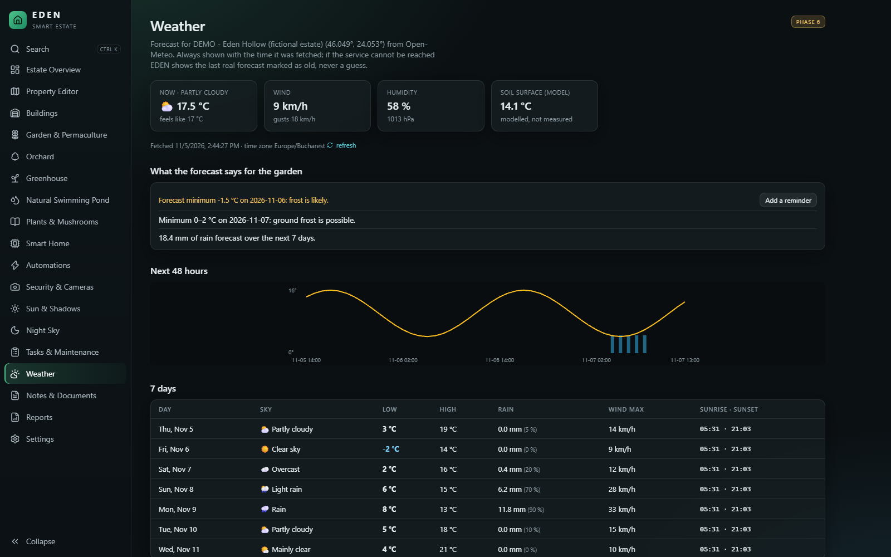
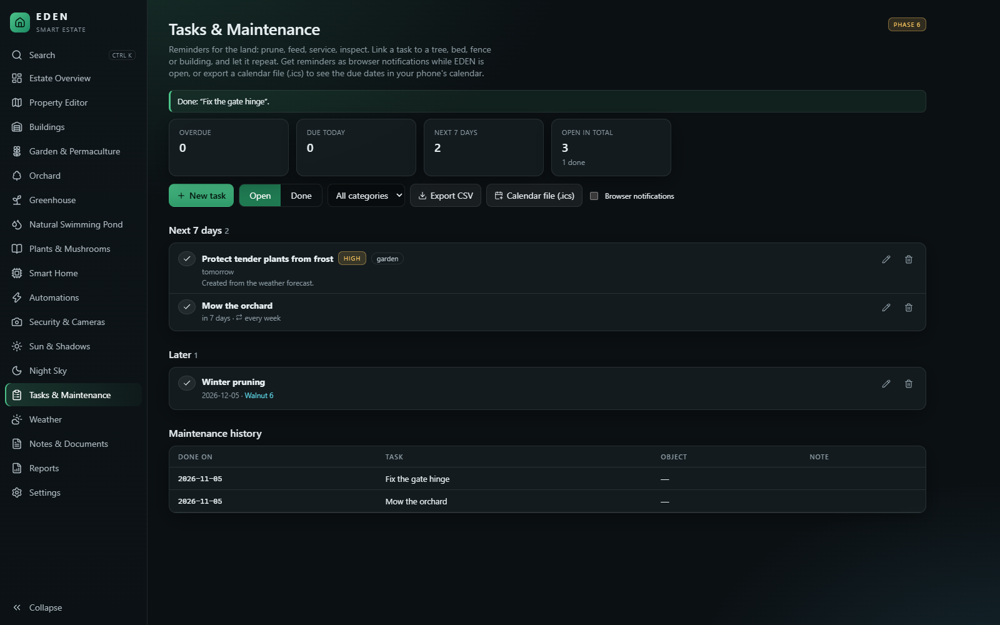
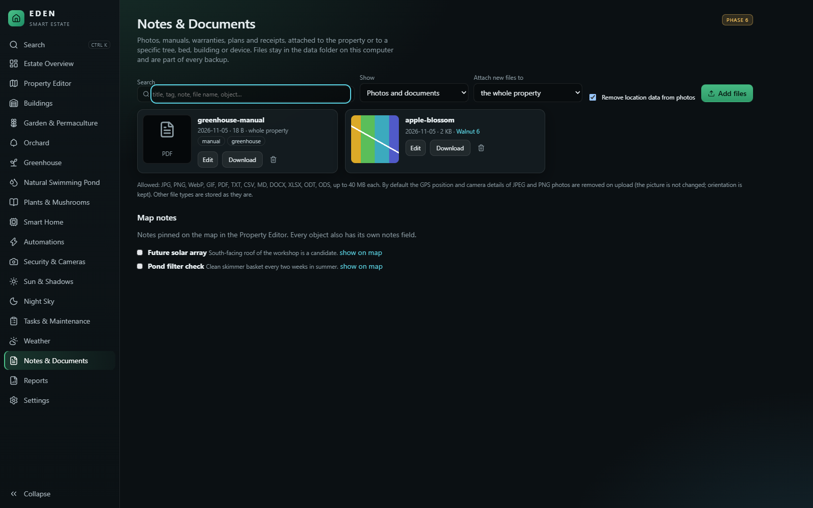
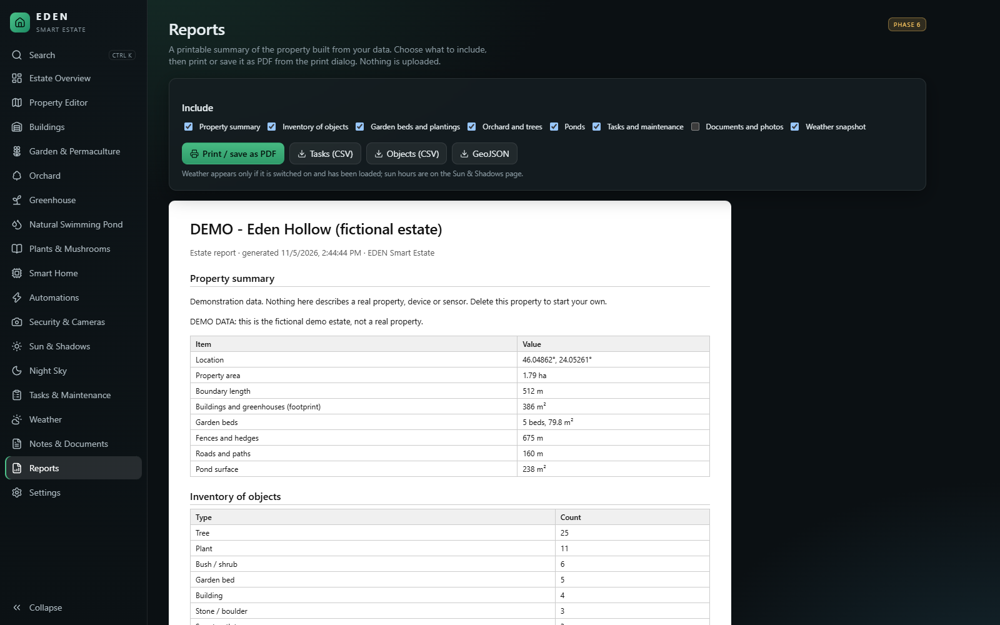
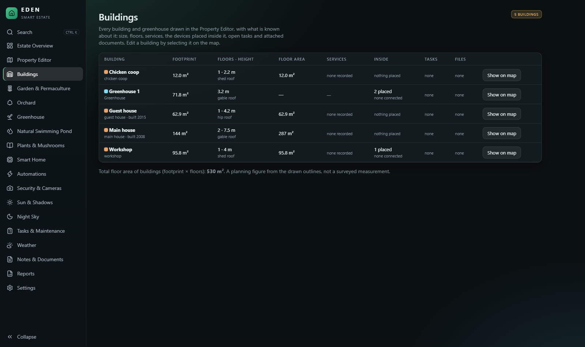
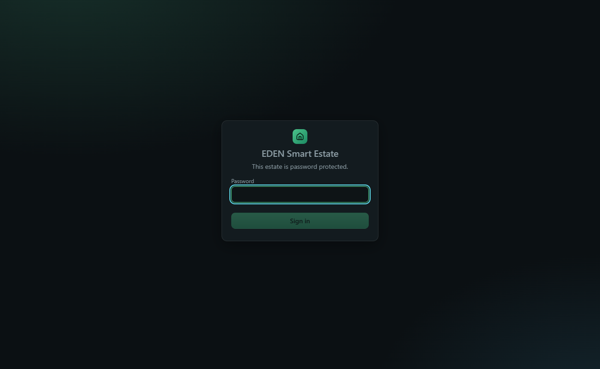
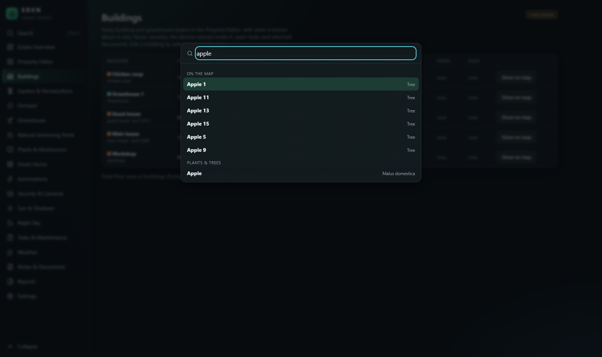

# EDEN — Smart Estate

**A digital twin of your land.** Open a satellite image of your real property, trace its boundary, and gradually turn it into an editable, measured, geographic model — buildings, fences, trees, garden beds with companion-planting checks, an orchard, a greenhouse and a natural swimming pond — stored on your own computer, no cloud subscription required.

> **Status: v1.1.0 (MIT licence).** All seven planned phases are done (property editor, landscape design, plant library, sun & shadows, night sky, smart home, cameras, automations, tasks, documents, weather, reports, installer, optional password protection).
> The map, object system, editor, measurements, layers, image calibration, 2D/3D, import/export and backup (v0.1) come with garden-bed planting plans, evidence-labelled companion planting, orchard records, greenhouse and natural-pond planning, a plant library (v0.2), and now **real sun positions, cast shadows, sun hours per bed and a night-sky chart** (v0.3), and **Home Assistant / MQTT devices, camera pictures and simple automations** (v0.4). **tasks, documents and photos, an opt-in weather forecast and printable reports** (v0.5). and, in v1.0, a **Windows installer, optional password protection, faster start-up and an accessibility audit** and appear in the app as clearly-marked *soon* pages. EDEN never fakes sensor values, camera feeds or device connections.


## What works today

**Map and imagery**
- Satellite, hybrid, street and terrain base maps through a **configurable provider layer** (Esri World Imagery out of the box, MapTiler or any XYZ tile server with your own key). No tile scraping; provider attribution is always shown. API keys stay on the server and are never sent to the browser.
- Search by place name or by `lat, lng` coordinates.
- **Bring your own aerial photo or plan:** import a PNG/JPEG/WebP and calibrate it with two known points, a known distance + bearing, or a world file.

**Property editor**
- Draw **property boundary, zones, buildings (12 presets), greenhouses, fences (6 types), hedges, gates, roads, paths, garden beds, trees (13 fruit/nut presets), bushes, plants, ponds, pipes, drainage, cables, smart outlets, cameras, lights, sensors, solar and notes.**
- Polygons as free shapes, rectangles or circles; lines and points; **snapping** to existing corners and edges.
- Every shape stays editable: **move, reshape, add/remove corners, rotate, scale, duplicate, delete, rename, recolour, move between layers.**
- Per-object properties panel with live measurements (area in m² and ha, perimeter, edge lengths, fence sections…), **17 layers** (show/hide, lock, rename, recolour, reorder), **unlimited undo/redo**, **autosave**, **2D ↔ 3D**.
- Import GeoJSON/KML; export GeoJSON, KML, CSV and a full project file; one-click full **backup & restore**.

**Landscape design (new in v0.2)**
- **Plant library:** 100 plants and trees (vegetables, herbs, fruit and nut trees, native forest trees, wild edibles, climbers, flowers, toxic plants), 25 aquatic plants, 10 pond fish and 26 mushrooms. Filter by name (common, Latin, Romanian), category, native status, sun, water, edibility, winter hardiness, flowering and harvest month, mature height, wildlife value and *companion of…*. **ADD TO PROPERTY** arms the map so you place that species with one click.
- **Companion planting with honest evidence:** 49 recorded relationships, each labelled **documented**, **mixed** or **traditional**. Green = documented compatibility, yellow = conditional or only traditional/mixed evidence, red = known incompatibility. Tomato + marigold (nematodes) is *documented*; tomato + basil is *traditional*; tomato + potato is red, and so are tomato, potato and apple near a walnut tree (juglone, checked out to 15 m). Nothing is invented — and where the library has no entry it says so.
- **Garden beds:** list the crops, counts, spacing and sowing dates per bed; room-for-N estimates, overcrowding warnings, expected harvest windows, and a pair-by-pair companion check. Select any plant to see **green/yellow/red links** to neighbours on the map.
- **Orchard:** per-tree species, variety, planting year → **age**, projected **mature canopy** (toggle on the map), pruning / fertilisation / pest logs, **pollination partner finder** (same species, different variety, within 50 m) and an **orchard statistics page**. **Plant a grid** of trees into an orchard area at chosen spacing, row angle and stagger — undone in one step.
- **Greenhouse:** footprint, true length × width and orientation, interior items (beds, shelving, doors, vents, heater, fan, lights, irrigation, tank), target temperature/humidity/soil-moisture ranges. Monitoring shows **“no sensors connected”** until a real integration exists.
- **Natural swimming pond:** area, **estimated volume** from depth zones, equipment (pump, filter, skimmer, waterfall, steps, stones, stream), aquatic plants by zone with **invasive-species warnings**, fish stock with **suitability warnings** (koi, goldfish, grass carp flagged), and a manual **water-quality log** with trend chart and range warnings.
- **Safety:** medicinal entries are **traditional use only**; toxic plants and mushrooms carry loud warnings; the mushroom library never claims anything is safe from a photo (and bundles no photos).

| Select and edit | 3D view |
|---|---|
|  |  |
| **Garden bed planting plan with companion check** | **Companion links on the map** |
|  |  |
| **Plant library** | **Mushroom safety** |
|  |  |
| **Natural pond: fish and water quality** | **Projected mature canopy** |
|  |  |
| **Cast shadows and sun hours per bed** | **Sun-hours map for the whole property** |
|  |  |
| **Midwinter shadows (same estate, 21 December)** | **Night sky** |
|  |  |
| **Smart Home (test fixture, not real devices)** | **Automations with activity log** |
|  |  |
| **Cameras: picture, unreachable camera, missing ffmpeg** | **Integration offline: values marked last known** |
|  |  |
| **Weather (test fixture forecast)** | **Tasks and maintenance** |
|  |  |
| **Notes & documents** | **Printable report** |
|  |  |
| **Buildings** | **Sign-in screen (password protection)** |
|  |  |
| **Search everything with Ctrl+K** | |
|  | |

<details><summary>More screenshots</summary>


</details>

> The screenshots show the fictional **demo estate** placed on a random open meadow. It is not a real property. The demo's garden bed 5 deliberately pairs potato with tomato, and its pond holds a goldfish, to show the warnings.

**Sun, shadows and sky (new in v0.3)**
- **Sun position** for your exact coordinates, any date and time, in any time zone: azimuth, elevation, sunrise, solar noon, sunset, day length, civil/nautical/astronomical twilight, and the length of a 1 m post's shadow. Standard astronomical formulas (sun to about 0.01°); tested against almanac values.
- **Cast shadows on the map** from every visible building, greenhouse, fence, hedge, tree and bush, with a time-of-day slider and an animated day. Drag a building and watch its shadow move. Trees cast lighter shadows when bare and denser ones in leaf; evergreens shade all year.
- **Sun hours** for every garden bed, greenhouse bed, orchard area and pond on the selected date and on the four season days (March/September equinox, June/December solstice), plus a **whole-property sun-hours map**. Library plants are checked against their light needs ("tomato wants 6 h+, this bed gets 4.3 h").
- **Sun-path diagram** (looking down on the property, north up) with the four season arcs and the day's hours marked.
- **Night sky:** an all-sky chart for your location and time — about 100 bright stars with simplified constellation figures, the five naked-eye planets, the Moon with phase, and the twilight colour of the sky. Moonrise/moonset, next full and new moon, and the **moon-free dark window** for stargazing. Hover anything for its name.
- Honest limits are shown in the app: flat ground (no terrain), roofs as boxes, foliage transmission is an estimate, planets are accurate to about 1°, and EDEN does not know the cloud cover.

**Smart home, cameras and automations (new in v0.4)**
- **Home Assistant** (REST API with a long-lived token) and **MQTT** brokers. Switches, lights, sensors, locks, covers, climate, valves and cameras are imported; you can rename them, link each to its position on the map and mark it *risky*.
- **Only real reports are shown.** A device whose integration has not reported a value says **no data**; if Home Assistant goes offline the values are marked *last known* and controls are disabled. Nothing is simulated or defaulted. Without any integration the app shows no device status at all.
- **Control with safeguards:** on/off, lock/unlock, open/close. Risky devices (locks, covers, heating, valves by default) ask for confirmation, and after each command the state shown is read back from the integration.
- **Cameras:** snapshot (JPEG) URLs, MJPEG streams, RTSP (via ffmpeg, if installed) and Home Assistant cameras, in a grid with full screen. Pictures and passwords go through the EDEN server, so credentials never reach the browser; a camera that cannot be reached shows why, never an old picture.
- **Automations:** *when* a device changes (becomes / rises above / falls below) or at a time of day, *if* conditions hold, *then* control devices or write to the log. Dry run, activity log, a one-minute cooldown, no action on unknown or offline states, and unattended rules on risky devices only after you acknowledge it. Clearly labelled as convenience, **not a safety system**.
- Credentials are stored on this computer, write-only in the API (and therefore part of a full backup file: keep backups private).
- Not included: automatic ONVIF discovery, recording or motion detection, a visual node editor, per-user accounts. The screenshots below use a clearly labelled **test fixture** instead of real devices.

**Management (new in v0.5)**
- **Tasks & maintenance:** reminders with due dates, priority and category, linked to any tree, bed, fence or building. Repeating tasks (every N days/weeks/months/years) either keep their rhythm (missed occurrences are skipped) or count from when you finish. Overdue / today / next 7 days views, a maintenance history ("when did I last prune this tree?") and CSV export. Reminders are shown inside EDEN only; nothing is pushed to a phone.
- **Notes & documents:** photos, PDFs, manuals, receipts, spreadsheets and text files attached to the property or to a specific object, with tags, notes, dates and search. Files live in the data folder, are checked by type **and content**, are served with `nosniff` and a sandbox policy, and travel with every backup.
- **Weather (opt-in):** a 7-day and 48-hour forecast from the free **Open-Meteo** service for the property's location, with plain facts derived from the numbers (frost likely on …, rain total, strong wind) and a one-click frost reminder. It is **off until you enable it** (it sends the rounded coordinates and your IP address to Open-Meteo), always shows when it was fetched, and falls back to the last real forecast marked as old, never a guess. It is a model forecast, not a measurement at your garden.
- **Reports:** a printable estate report (summary, inventory, beds with companion check, orchard, ponds, tasks, documents, weather) to print or save as PDF, plus CSV/GeoJSON exports.
- Not included: push notifications, e-mail reminders, a calendar view, OCR/full-text search inside documents, a global search across tasks and documents (each page has its own search).

## About the plant data

The library is a **curated starter set** written from general horticultural and botanical knowledge — *not* a citation-backed database and not exhaustive. Every companion relationship carries its evidence level; tradition is never presented as established science. Please verify anything important (especially toxicity, medicinal use and foraging) with local experts and sources. Entries are plain Python in `backend/app/library_*.py`, covered by integrity tests, and meant to be reviewed and extended.

**New in v1.1**
- **MIT licence** and a list of third-party components and data terms ([THIRD_PARTY_NOTICES.md](THIRD_PARTY_NOTICES.md)).
- **Search everything with Ctrl+K:** pages, map objects, plants (also by Romanian name, accents optional), tasks, documents, devices, automations, cameras.
- **HTTPS for your network:** `start.ps1 -Lan -Https` encrypts traffic with a self-signed certificate created on your computer.
- **Photos lose their GPS position** (and camera/date details) on upload; the picture itself is not touched.
- **Tasks in your calendar:** download a `.ics` file for your phone's calendar, or turn on browser notifications for overdue tasks.
- **Pitched roofs in the shadow model:** gable, hip, mansard and shed roofs cast their actual shape; optional wall height per building.
- **Tested with a real MQTT broker**, and the setup offers to install Python for you (winget) if it is missing.

**Polish and safety (v1.0)**
- **Windows installer:** download the zip, double-click `Install-EDEN.cmd`: no administrator rights, Start Menu entries, *Installed apps* entry, optional autostart; **your data lives in its own folder** so updates never touch it; an uninstaller keeps your data unless you type `DELETE`.
- **Password protection:** `start.ps1 -Lan` requires a password (also available for local use): signed sessions, lock-out after repeated failures, cross-site write protection. Add `-Https` to encrypt the connection: see [SECURITY.md](SECURITY.md).
- **Fast start-up:** about 190 kB of script on first load (pages and the map engine load on demand); a 3000-object benchmark guards performance.
- **Accessibility and resilience:** automated axe-core audit of every page, labelled controls, visible focus, zoom allowed; a crashing page shows a message instead of a blank screen.
- **Buildings page:** footprint, floors, floor area, services, devices inside, tasks and files per building.

## Install (Windows 11)

You need **Python 3.11 or newer** ([python.org](https://www.python.org/downloads/), tick *Add python.exe to PATH*). Node.js is only needed if you build from source.

**From the release:** download `EdenSmartEstate-1.1.0.zip`, extract it and double-click **`Install-EDEN.cmd`**. Then start *EDEN Smart Estate* from the Start Menu.

**From source:**

```powershell
git clone https://github.com/unupunct/Eden-Smart-Estate.git
cd Eden-Smart-Estate
powershell -ExecutionPolicy Bypass -File scripts\install.ps1
powershell -ExecutionPolicy Bypass -File scripts\start.ps1
```

Your browser opens at <http://127.0.0.1:8787>. Click **Explore the demo estate**, or **Create my property**. Your existing data is migrated automatically when you update.

The complete guide (installer options, LAN/tablet access with a password, autostart, updating, backup, uninstall) is in **[docs/INSTALL.md](docs/INSTALL.md)**; problems are covered in **[docs/TROUBLESHOOTING.md](docs/TROUBLESHOOTING.md)**.

## Documentation

| | |
|---|---|
| [Installation guide](docs/INSTALL.md) | Step by step, plus LAN access, autostart, updates, troubleshooting |
| [User guide](docs/USER_GUIDE.md) | Drawing, editing, layers, measuring, planting plans, orchard, pond, library, sun & shadows, night sky, smart home, cameras, automations, tasks, documents, weather, reports, shortcuts |
| [Architecture & data model](docs/ARCHITECTURE.md) | Object model, coordinates, autosave/undo design, library data model, database schema |
| [API & integrations](docs/API.md) | REST endpoints, import/export formats, imagery providers, key handling |
| [Security notes](SECURITY.md) | What is protected, what is not, LAN use, credentials, uploads |
| [Troubleshooting](docs/TROUBLESHOOTING.md) | Symptoms and fixes for install, map, devices, cameras, weather |
| [Changelog](CHANGELOG.md) | What changed in each version |
| [Development](docs/DEVELOPMENT.md) | Build, test, extend (object kinds, plant data, migrations, providers) |

## Tech

React 18 + TypeScript + Vite · MapLibre GL JS (maps, 2D/3D) · Zustand · FastAPI · SQLite (portable SQL, ready for PostgreSQL) · 150 frontend unit tests, 116 backend tests (including TLS and a real MQTT broker), six browser end-to-end suites (35 + 34 + 23 + 29 + 41 + 11 checks) and an accessibility audit of all 18 pages.

## Data, privacy and imagery

- All your data lives in the local `data/` folder (SQLite database + imported images). Nothing is uploaded anywhere by EDEN.
- **Weather** is the one feature that sends your property's coordinates to a third party (Open-Meteo), and only after you enable it on the Weather page.
- Your **browser** requests map tiles directly from the imagery provider you select (so that provider sees your IP address and viewed area, like any web map). Place search goes through your local EDEN server to OpenStreetMap Nominatim and is only sent when you press Enter. Both are optional; the editor and the plant library work offline with stored data.
- Please read your imagery provider's terms. Esri World Imagery is shown with its required attribution; heavy or commercial use calls for your own key from a provider such as MapTiler.
- By default EDEN listens on `127.0.0.1` only. `-Lan` mode needs a password, uses plain HTTP and should stay on a trusted network: see [SECURITY.md](SECURITY.md).

## Roadmap

| Phase | Scope | Status |
|---|---|---|
| 1 | Foundation: architecture, database, navigation, property creation, imagery, image calibration | ✅ done (v0.1) |
| 2 | Property editor: boundary, measurements, layers, objects, buildings, fences, notes, undo/redo, autosave | ✅ done (v0.1) |
| 3 | Landscape design: bed planting plans, orchard records, greenhouse, pond, plant library, sourced companion planting | ✅ done (v0.2) |
| 4 | Environment: sun position, real shadow projection, seasonal comparison, night sky | ✅ done (v0.3) |
| 5 | Smart home: Home Assistant, MQTT, outlets, sensors, cameras, automation editor | ✅ done (v0.4) |
| 6 | Management: tasks, maintenance, documents, photos, weather, reports | ✅ done (v0.5) |
| 7 | Polish: performance, installer, further docs | ✅ done (v1.0) |

Known limitations of v1.1.0: the installer is a PowerShell setup (not a signed `.exe`, so Windows may show an execution-policy or SmartScreen prompt) and needs Python 3.11+ (it can install it through winget) and internet for the first install; access is one shared password, no user accounts, and `-Https` uses a self-signed certificate that browsers warn about once; photo cleaning covers JPEG and PNG (WebP, GIF, PDF and Office files are stored as they are); reminders are browser notifications while EDEN is open plus a calendar file (no push or e-mail); weather is a model forecast from one provider and needs internet; no OCR or search inside documents; no ONVIF discovery, recording or motion detection for cameras; automations are simple rules (one trigger, a few conditions, device and log actions) that run only while EDEN runs; RTSP cameras need ffmpeg and that path has only been tested with a fake (MQTT is tested against a real broker, Home Assistant against a fake); the 3D view still shows buildings as boxes (shadows use the pitched roof); there is no terrain elevation, so hills and neighbouring buildings outside your property cast no shade; foliage light transmission and greenhouse glazing are estimates; the night sky shows about 100 stars and five planets (no deep-sky objects, satellites or cloud forecast; planets ±1°); the plant library has no photographs and only about a hundred plants; pollination checks use species and variety names, not full cultivar pollination groups; GeoTIFF is not read directly (use PNG/JPEG + world file); touch use is supported but has only been tested with emulated input.

## License

EDEN Smart Estate is released under the **[MIT License](LICENSE)**: free to use, change and share, with no warranty. Third-party components and data services keep their own terms: see [THIRD_PARTY_NOTICES.md](THIRD_PARTY_NOTICES.md).
